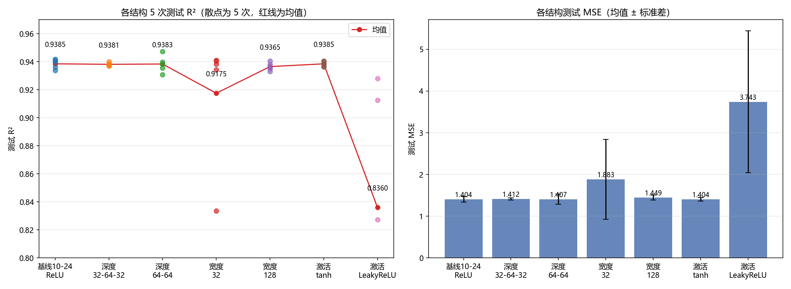
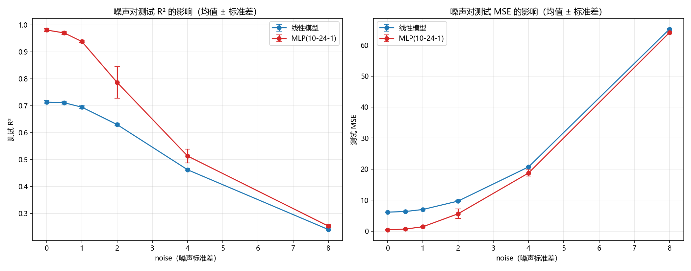

# 以下都是ai生成的，我布置了任务（见之前的思考），然后直接看对应的文件结果情况。

# 延伸思考：网络结构实验 与 噪声影响实验

> 本实验为任务 2.2 的延伸思考。所有实验沿用已确认的最佳训练协议：**Adam(lr=0.001, weight_decay=1e-4)**、全批量、每训练一步在验证集评估（不参与训练）、早停 patience=1000、10000 步上限、恢复验证集最优权重；数据为 `make_friedman1(n_samples=1500, n_features=10, noise=1.0, random_state=42)`，划分 60/20/20（random_state=42，与之前所有实验一致）。每种配置独立训练 5 次（种子 42~46），报告均值 ± 标准差。

---

## 一、延伸思考 1：网络结构实验

### 1.1 实验设计

在"lr=0.001 + L2"的基础上，只改变网络结构，控制其他条件完全一致：

| 编号 | 结构 | 改动维度 | 参数量 |
|---|---|---|---|
| 基线 | 10-24-1，ReLU | 参照（= exp1 最优配置） | 289 |
| 深度 1 | 10-32-64-32-1，全 ReLU | 深度：1 层 → 3 层隐藏层 | 4577 |
| 深度 2 | 10-64-64-1，全 ReLU | 深度：2 层隐藏层 | 4929 |
| 宽度 1 | 10-32-1，ReLU | 宽度：24 → 32 | 385 |
| 宽度 2 | 10-128-1，ReLU | 宽度：24 → 128 | 1537 |
| 激活 1 | 10-24-1，**tanh** | 激活：ReLU → tanh | 289 |
| 激活 2 | 10-24-1，**LeakyReLU(0.1)** | 激活：ReLU → LeakyReLU | 289 |

注意：激活函数实验只改隐藏层激活，输出层始终为线性（回归输出必须无界）。

### 1.2 实验结果（5 次均值 ± 标准差）

| 结构 | 参数量 | 测试 MSE | 测试 R² | 平均停止步数 |
|---|---|---|---|---|
| 基线 10-24-1 ReLU | 289 | 1.4041 ± 0.0699 | **0.9385 ± 0.0031** | 9118 |
| 深度 10-32-64-32-1 | 4577 | 1.4121 ± 0.0259 | 0.9381 ± 0.0011 | 2578 |
| 深度 10-64-64-1 | 4929 | 1.4074 ± 0.1221 | 0.9383 ± 0.0054 | 3060 |
| 宽度 10-32-1 | 385 | 1.8829 ± 0.9592 | 0.9175 ± 0.0420 | 8670 |
| 宽度 10-128-1 | 1537 | 1.4494 ± 0.0592 | 0.9365 ± 0.0026 | 5810 |
| 激活 tanh 10-24-1 | 289 | 1.4043 ± 0.0400 | **0.9385 ± 0.0018** | 10000 |
| 激活 LeakyReLU 10-24-1 | 289 | 3.7426 ± 1.6977 | 0.8360 ± 0.0744 | 7838 |

### 1.3 结果分析

**（1）增加深度（32-64-32、64-64）：精度不变，但收敛更快、更稳定。**
两个深层结构 R² 与基线几乎相同（0.9381 / 0.9383 vs 0.9385），但平均停止步数从 9118 降到 2578 / 3060——**深层网络找到好解更快**；深度 32-64-32 的 5 次方差是所有结构里最小的（std 0.0011）。说明：单隐藏层 24 宽对这个任务**表达能力已经足够**，加深没有带来精度收益，只是让优化更容易。

**（2）宽度 32：均值明显下降，出现 1/5 次失败（0.8336）。**
窄网络（32 神经元）5 次中 1 次退化到坏盆地（最优验证损失 3.96，远高于正常的 ~1.5），拖低均值到 0.9175。**容量不足时，坏盆地问题更容易出现**——这呼应了 2.2 基线的诊断：宽度也是影响"能否成功优化"的因素之一。

**（3）宽度 128：无增益，甚至略低于基线。**
0.9365 vs 0.9385。容量已经饱和，继续加宽只是增加参数（1537）而不提升性能。

**（4）激活函数 tanh：与基线打平，最稳定，但收敛最慢。**
R² 0.9385（std 0.0018），5 次全部跑满 10000 步才停。原因：tanh 在饱和区梯度趋近于 0，lr=0.001 下更新更慢；但它的对称输出也带来了更一致的轨迹（5 次结果差异很小）。

**（5）激活函数 LeakyReLU：明显最差、最不稳定。**
0.8360 ± 0.0744，5 次中 2 次严重退化（0.7405 / 0.7716，几乎回到线性水平）。在同样的 lr=0.001 下，LeakyReLU 的负斜率改变了梯度分布，使坏盆地问题比 ReLU 更严重——这是本次实验最意外的发现。

### 1.4 回答问题：哪种结构最好？是否符合预期？

- **精度最好**：基线 ReLU 与 tanh 并列最高（0.9385）。
- **综合最好**：**10-32-64-32-1（0.9381，方差最小、收敛最快 2578 步）**——精度与最好水平仅差 0.0004，但训练成本只有基线的 1/4。
- **是否符合预期**：**部分不符合**。原以为"加深/加宽 → 更强"，实际加深加宽几乎不改变最终精度，因为 24 宽单隐藏层已足够表达 Friedman#1；**本任务的瓶颈是优化而非容量**。符合预期的是：更宽/更深的网络更容易稳定地找到好解（方差小），而过窄（32）或不利激活（LeakyReLU）的网络会重新暴露坏盆地问题。

---

## 二、延伸思考 2：研究噪声对模型的影响

### 2.1 实验设计

用 `make_friedman1(..., noise=N)` 从较小到较大生成 6 组数据：**N = 0.0 / 0.5 / 1.0 / 2.0 / 4.0 / 8.0**（random_state=42，划分方式固定）。每个噪声下测试两个模型：**线性（10-1）** 与 **MLP（10-24-1 ReLU）**，都采用 lr=0.001 + L2 的最优训练协议，各 5 次重复。

### 2.2 实验结果（5 次均值 ± 标准差）

| noise | 线性 MSE | 线性 R² | MLP MSE | MLP R² | MLP−线性 R² |
|---|---|---|---|---|---|
| 0.0 | 6.118 ± 0.118 | 0.7134 ± 0.0055 | 0.402 ± 0.123 | 0.9812 ± 0.0058 | **+0.268** |
| 0.5 | 6.309 ± 0.122 | 0.7113 ± 0.0056 | 0.647 ± 0.135 | 0.9704 ± 0.0062 | +0.259 |
| 1.0 | 6.966 ± 0.127 | 0.6948 ± 0.0056 | 1.404 ± 0.070 | 0.9385 ± 0.0031 | +0.244 |
| 2.0 | 9.679 ± 0.136 | 0.6302 ± 0.0052 | 5.582 ± 1.530 | 0.7867 ± 0.0585 | +0.157 |
| 4.0 | 20.702 ± 0.155 | 0.4625 ± 0.0040 | 18.736 ± 1.003 | 0.5135 ± 0.0261 | +0.051 |
| 8.0 | 65.141 ± 0.197 | 0.2402 ± 0.0023 | 64.044 ± 0.460 | 0.2530 ± 0.0054 | +0.013 |

### 2.3 结果分析（对应三个问题）

**（1）噪声增加后，模型性能发生了什么变化？**

两者都是**单调下降**：MLP 的 R² 从 0.981（无噪声）一路降到 0.253（noise=8），线性从 0.713 降到 0.240；MSE 同步上升（MLP 0.40→64，线性 6.1→65）。这是必然的——噪声直接叠加在目标上，构成任何模型都无法消除的"不可约误差"。

**（2）两类模型受到的影响是否完全相同？**

**不完全相同，但方向一致。**
- 绝对下降幅度：MLP 更大（R² 掉 0.73），线性较小（掉 0.47）——因为 MLP 起点高，能"失去"的也更多。
- **相对优势始终存在但持续缩小**：无噪声时 MLP 比线性高 0.268，到 noise=8 时只剩 0.013，几乎追平。也就是说，**MLP 的非线性优势在噪声主导下被逐步稀释**。
- 两个额外细节：线性模型在 **noise=0 时 R² 也只有 0.71**——证明 Friedman#1 的目标本身含强非线性（sin、乘积项），线性模型即使没有噪声也结构性欠拟合；MLP 在 noise=2 时出现 1/5 次退化（0.6733），说明**中等噪声下优化稳定性变差**，而噪声极大时（4、8）坏盆地与好盆地都被噪声抹平，5 次反而都收敛到相近水平。

**（3）数据随机性很大时，单纯增加模型复杂度是否仍然有效？**

**仍然有效，但收益急剧缩小。** 在 noise=8 时 MLP 依然略优于线性（R² 0.253 vs 0.240，MSE 64.0 vs 65.1），说明复杂度不是无效的；但差距只有 0.013，而噪声主导了绝大部分误差——此时**提升性能主要应靠降噪/更多数据，而不是继续增加模型复杂度**。这也解释了为什么噪声实验里 MLP 平均停止步数随噪声增大而减少（noise=0 时 10000 步 → noise=8 时 2008 步）：大噪声下验证损失很快进入噪声底，早停更快触发。

---

## 三、两个实验的总结

1. **结构实验**：在"优化得当"（lr=0.001+L2）的前提下，Friedman#1 任务的瓶颈是**优化而非容量**——24 宽单隐藏层已足够，加深/加宽不提升精度；但结构仍影响**收敛速度与稳定性**（深层更快更稳，过窄和 LeakyReLU 会重新触发坏盆地退化）。
2. **噪声实验**：噪声单调侵蚀所有模型的性能；MLP 始终优于线性，但**优势随噪声增大而缩小**；在大噪声下，复杂度收益趋近于 0，数据质量比模型复杂度更重要。
3. 两个实验互相印证了 2.2 基线的核心结论：**"网络有能力 ≠ 一定能学好"，优化（学习率、结构、正则）与数据质量共同决定最终结果**。

### 附：产物文件

| 文件 | 说明 |
|---|---|
| `2.4.1 延伸思考1-网络结构/struct_exp.py` | 结构实验脚本（7 结构 × 5 次） |
| `2.4.1 延伸思考1-网络结构/struct_exp_results.txt` | 结构实验完整明细与汇总 |
| `2.4.1 延伸思考1-网络结构/struct_exp_compare.png` | 结构对比图（R² 与 MSE） |
| `2.4.2 延伸思考2-噪声影响/noise_exp.py` | 噪声实验脚本（6 噪声 × 2 模型 × 5 次） |
| `2.4.2 延伸思考2-噪声影响/noise_exp_results.txt` | 噪声实验完整明细与汇总 |
| `2.4.2 延伸思考2-噪声影响/noise_compare.png` | 噪声影响曲线图（R² 与 MSE） |
